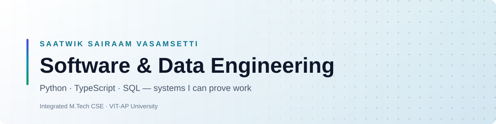
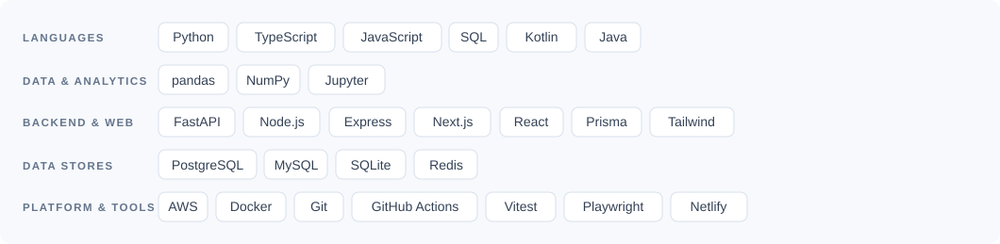

<picture>
  <source media="(prefers-color-scheme: dark)" srcset="assets/banner-dark.svg">
  
</picture>

  
  
  
  

---

## About

I build systems and then prove they work. Most of what's below ships with a test
suite, a README that says plainly what is real and what is mocked, and a build
you can run yourself in one command.

Currently an Integrated M.Tech CSE student at **VIT-AP University**, working
across data pipelines and full-stack engineering — Python and SQL on the data
side, TypeScript and Node on the product side.

- **Building** — a research and trading toolkit, and the backend of an offline-first emergency platform
- **Focused on** — data engineering, backend architecture, and testing that actually catches things
- **Ask me about** — Python, SQL, TypeScript, FastAPI, Next.js, database design
- **Reach me** — [saathwik.13@gmail.com](mailto:saathwik.13@gmail.com) · [saatwik-1157.github.io](https://saatwik-1157.github.io)

> I'd rather ship something with a failing test I can see than something that only looks finished.

---

## Tech

<picture>
  <source media="(prefers-color-scheme: dark)" srcset="assets/stack-dark.svg">
  
</picture>

---

## Selected work

The numbers below come from each project's own tests and schema, not estimates.

| Project | What it does | Stack | Verified |
|---|---|---|---|
| **trade-research** (private, available on request) | Research and execution tooling where Python computes every figure and a verifier traces it back to its source. The back-test found no strategy with a demonstrable edge, and the README says so first | `Python` `FastAPI` `PostgreSQL` `React` | **6 models** benchmarked against 2 baselines |
| **[roadassist-bharat](https://github.com/saatwik-1157/roadassist-bharat)** | Offline-first emergency mobility platform. I led backend and cloud database in a four-person team | `TypeScript` `Fastify` `PostgreSQL` `PostGIS` | **1,600+ assertions** · 60 tables · 86 routes |
| **[SUMS](https://github.com/saatwik-1157/database_management_SUMS)** | Integrity rules live in the schema — proved by three API servers on top that re-implement none of them | `MySQL` `Express` `FastAPI` | **43 tables · 10 triggers · 4 procedures** |
| **[machinesense-ai](https://github.com/saatwik-1157/machinesense-ai)** | Predictive maintenance and digital-twin simulation, explaining each score per sensor | `FastAPI` `Vanilla JS` | 10 live endpoints |

<b>More projects</b>

 

| Project | What it does | Stack |
|---|---|---|
| [project_PathAhead](https://github.com/saatwik-1157/project_PathAhead) | Career-guidance platform running workshops for pre-college students — 44 pages, zero runtime dependencies, no build step | `HTML` `CSS` `JS` |
| [offerpilot](https://github.com/saatwik-1157/offerpilot) | Job-application platform for F-1/OPT students, with an OPT runway calculator | `Vanilla JS` |
| [saatwik-1157.github.io](https://github.com/saatwik-1157/saatwik-1157.github.io) | Personal portfolio, assembled live by animated agent cursors, with nothing to build | `HTML` `CSS` `JS` |

---

<b>Education &amp; certifications</b>

 

**Integrated M.Tech, Computer Science Engineering** — VIT-AP University (with Virtusa)

Google Analytics certification, plus AWS, SAP and Microsoft Learn courses and
Forage job simulations in data analytics.

<b>Why this page loads fast</b>

 

Most profile READMEs pull 30–40 images from half a dozen third-party services.
Those services rate-limit, go down, and leave broken images on your profile.

This one renders from **two self-hosted SVGs** committed to the repo and served
by GitHub's own CDN, plus four badges from a single host — five remote requests
in total. A visitor downloads about 9 KB of vector art (one variant per colour
scheme). It works offline in a clone, and it cannot break because someone else's
free tier lapsed.

---

  

